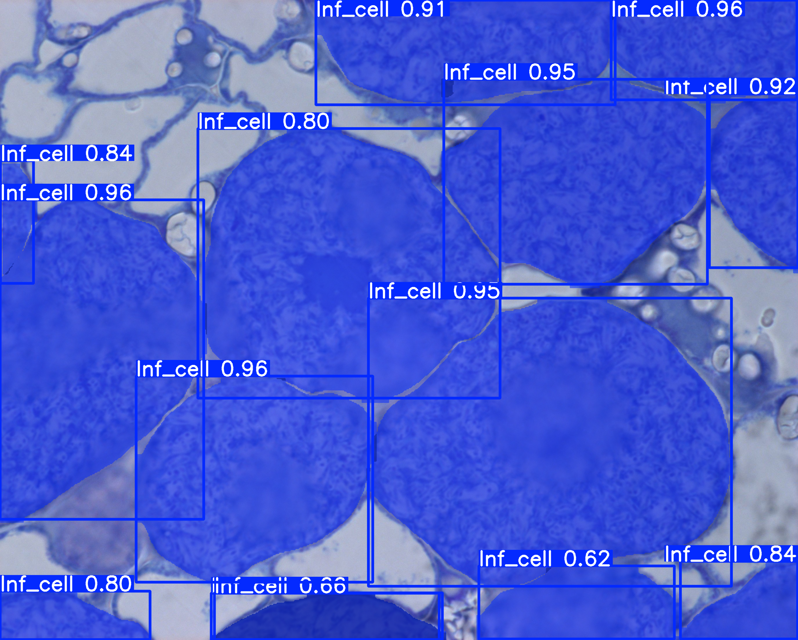

# An Automated Instance Segmentation Pipeline for Assessing Nitrogen Fixation Zone Heterogeneity Using YOLO26 Model
 `выходные данные статьи`
 <ссылка>

  

**Data**
 `Inf_cell_YOLOv26L-seg_vers2__learning_results.csv` - trained instance segmentation model performance
 `Symbiotic-nodule-occupancy.v1-nodule_micro_v1.yolo26.zip` - dataset and annotations in the YOLO26 format
 `data_2624.csv`, `data_3841.csv`, `data_AMPS22.csv` - raw data

**Analysis**
 `YOLO_nodule_infection.ipynb` - Jupyter Notebook script to detect infected cells on unannotated microphotographs
 `Cell-coverage comparison.ipynb` - Jupyter Notebook script to implement the pairwise two-sided permutation tests and Cohen's d, bootstrap confidence intervals for the mean difference
 `YOLOv26_cell.ipynb` - training environment on Google Colab

___
Created by Kirichek Evgenii - e.kirichek@arriam.ru

